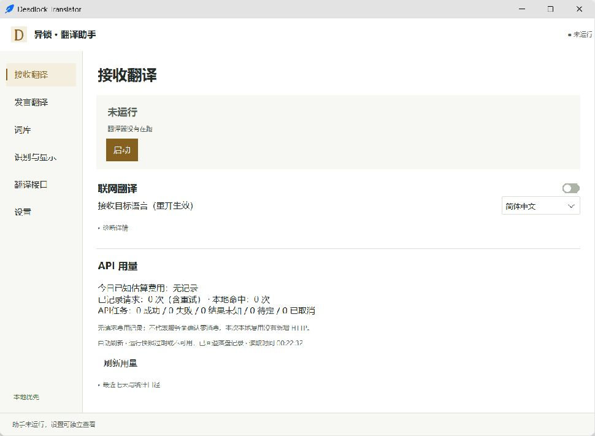
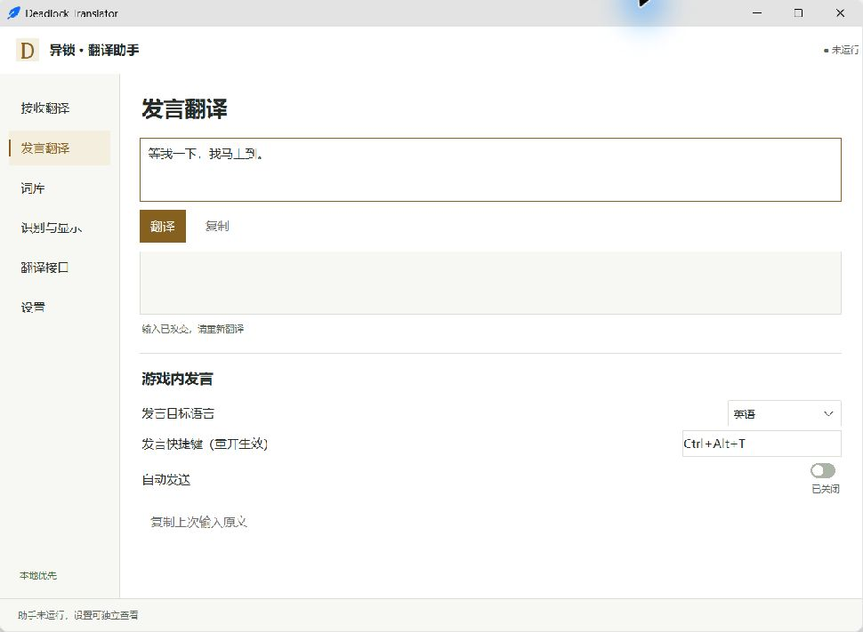

# 异锁聊天翻译助手 · Deadlock Translator

Windows《异锁》（Deadlock）聊天翻译工具。当前发布版本：**1.0.0-test.3（测试版）**。

**[下载 Windows 测试包](https://github.com/piaobo2233/deadlock-translator/releases/tag/v1.0.0-test.3)** · [直接下载 ZIP](https://github.com/piaobo2233/deadlock-translator/releases/download/v1.0.0-test.3/DeadlockTranslator-1.0.0-test.3-windows-x64.zip) · [反馈问题](https://github.com/piaobo2233/deadlock-translator/issues)

本版更新为六页导航，切页保留草稿，接口统一显式保存，并补充发言流程取消保护。游戏快捷键回填与自动发送仍待实测，详见发布说明。

新版Windows下载包已包含上述源码更新；真实游戏回填、发送与完整DPI/小窗口布局仍需验收。

## 功能

- 通过屏幕 OCR 识别英文聊天，翻译为简体中文；正文含汉字时整条跳过。
- 输入中文，检查英文预览后复制，自行粘贴到游戏发送。
- 优先使用本地词库和已保存的翻译；需要时调用配置的 API。

## 使用

运行环境：Windows 10/11 64 位。测试包包含 Python 运行环境，无需另行安装 Python。

1. 下载并完整解压 ZIP，保留 `DeadlockTranslate.exe` 和 `_internal` 文件夹。
2. 未安装 Tesseract OCR 时，先运行包内 `首次安装OCR` 的安装器，保留默认位置和 English 组件；所需识别模型已随助手附带。
3. 双击 `启动.vbs`。在“翻译接口”填写自己的 API Key、接口和模型并保存，在“接收翻译”按需开启联网翻译。API 用量由服务商计费。
4. 打开游戏。默认只在游戏前台识别，关闭主面板时退出助手。

详细说明：[安装与分享](docs/guides/首版测试与分享.md) · [接收与中文回复](docs/guides/接收与中文转英文.md)

## 限制与隐私

识别效果和翻译延迟仍需实际对局验证，可能漏译、误识别或超时。分辨率、缩放、网络及服务商响应均可能影响结果。测试包未做代码签名，可按下载页的 SHA-256 核对文件。

OCR 在本机完成；开启 API 后，待翻译文字会发送给配置的服务商。`data/` 保存配置、密钥和个人记录，分享时请使用初始 ZIP，勿重新压缩运行后的目录。

## 反馈与开发

遇到问题可[提交 Issue](https://github.com/piaobo2233/deadlock-translator/issues)，附 Windows 版本、分辨率与缩放、游戏显示模式、代理情况和复现步骤。勿上传密钥或完整 `data`，截图请遮挡昵称。

源码运行、构建及测试记录见[开发说明](docs/DEVELOPMENT.md)。源码采用 [MIT](LICENSE)，第三方许可见[第三方声明](docs/THIRD-PARTY-NOTICES.md)。本项目与 Valve 无关联，非官方产品。
