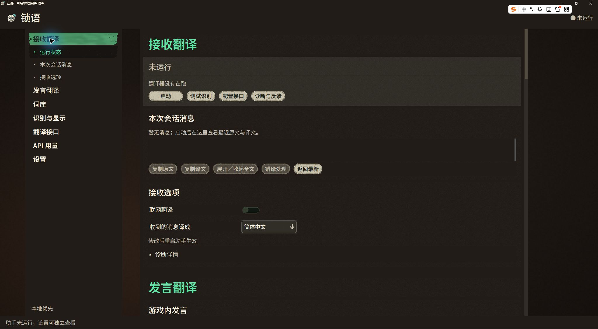

<h1 align="center">锁语 · LockLingo</h1>

《异锁》（Deadlock）的 Windows 聊天翻译助手

<strong>1.1.3 · Windows 10/11 x64 · 内置 OCR</strong>

  <a href="https://github.com/piaobo2233/deadlock-translator/releases/download/v1.1.3/LockLingo-1.1.3-setup.exe"><strong>下载安装包</strong></a> ·
  <a href="https://github.com/piaobo2233/deadlock-translator/releases/tag/v1.1.3">便携版与校验</a> ·
  <a href="docs/CHANGELOG.md">更新日志</a>

## 主要功能

- **接收翻译**。本机 OCR 读取聊天，默认在浮窗显示简体中文。面板可查看并复制原文和译文。
- **发言翻译**。主动开启后，在游戏中复制中文，助手把英文译文写入剪贴板，由你粘贴并发送。
- **本地优先**。先查词库、记忆和缓存，未命中时可调用你配置的翻译服务。服务商可能计费。

## 安装、更新与卸载

- **首次安装**。选择纯英文可写目录，例如 `D:\LockLingo`。在首次设置中确认聊天识别范围，可先用参考范围和本地词库。
- **更新**。安装版在「设置 → 软件更新」检查更新，也可将新安装包覆盖到原目录。个人资料随原目录保留。
- **卸载**。安装版在「设置 → 卸载 → 卸载锁语」打开卸载程序。彻底卸载时，在保留资料提示中选「否」，会永久删除安装目录内的个人资料和锁语备份。

详见[安装与首次使用](docs/guides/安装与首次使用.md)。

## 使用范围

主要面向主屏全屏或无边框模式。不同分辨率、缩放和对局场景下的识别效果会有差异。启用联网翻译后，待译文字会发给所选服务商。个人资料保存在程序目录的 `data/`。

[文档](docs/README.md) · [测试状态](docs/TESTING.md) · [反馈问题](https://github.com/piaobo2233/deadlock-translator/issues/new/choose) · [第三方许可](docs/THIRD-PARTY-NOTICES.md)

原创源码采用 [MIT](LICENSE)。锁语由社区独立维护，感谢开源项目和玩家的反馈。 [项目与素材说明](docs/PROJECT-NOTICE.md)
