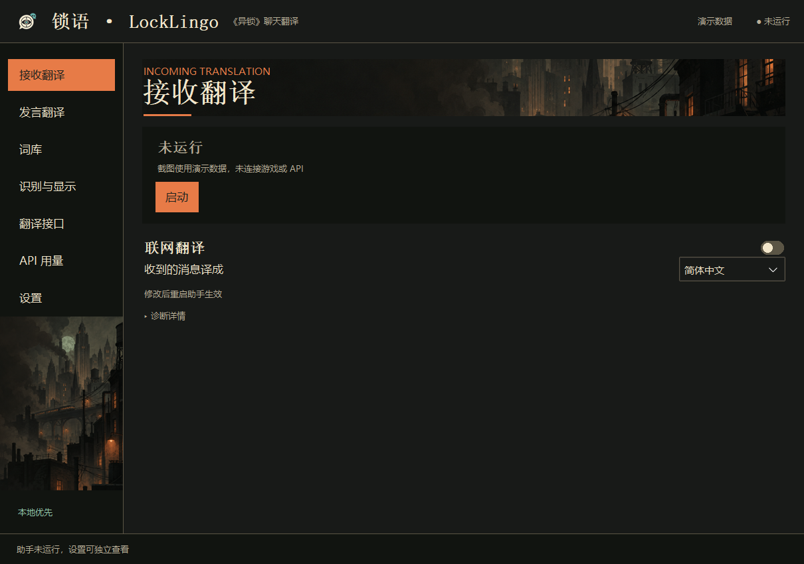
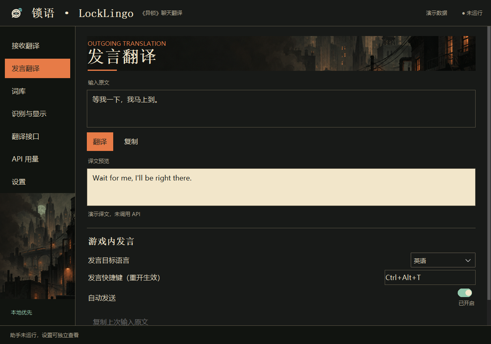
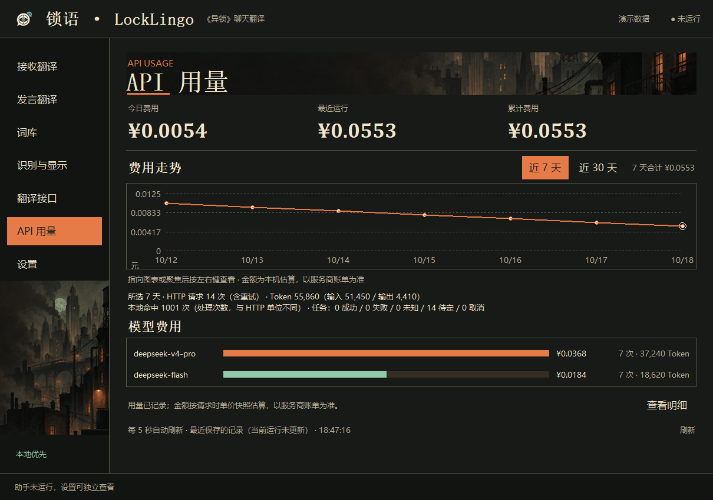

# 锁语 · LockLingo

为《异锁》（Deadlock）玩家提供聊天翻译和跨语言回复的 Windows 桌面工具。

**Windows 10/11 · 64 位** · [MIT 原创源码](LICENSE)

[下载已发布版本](https://github.com/piaobo2233/deadlock-translator/releases) · [安装与首次使用](docs/guides/安装与首次使用.md) · [更新日志](docs/CHANGELOG.md) · [反馈问题](https://github.com/piaobo2233/deadlock-translator/issues/new/choose)

> **当前源码：1.0.0-test.4-rc.4。公开下载：1.0.0-test.3。**
>
> rc.4 包含多语种、七页控制界面、独立 API 用量、更新提醒与安装版一键更新，以及近期稳定性修复。新安装包目前用于本地验收，尚未发布正式 1.0；旧 test.3 下载包不包含全部新功能。完整安装、干净 Windows 和第三方分发材料仍有待完成项目，详见[测试状态](docs/TESTING.md)。

## 当前源码能做什么

- **接收翻译**：在本机截取聊天区域并 OCR，将聊天翻译成所选的一种语言，默认简体中文。默认接收英语、西班牙语、葡萄牙语、法语、德语、日语、韩语和俄语；含假名日文及中外文混合正文已有对应处理。纯中文保持原样，只有汉字的中日文歧义短句保守处理。八语已有合成素材验证，实际对局效果仍需验收。
- **跨语言回复**：输入中文或其他文字，选择目标语言，检查预览后复制；也提供游戏快捷键回填和可选自动发送。真实游戏输入仍在测试，自动发送默认关闭。
- **本地优先**：先查询有效词库、记忆和缓存；允许联网时，未命中的文字才请求所配置的翻译接口。API 需自备 Key，费用由服务商收取。
- **词库与审核**：查看、编辑、导入导出正式词条，审核候选译文；切页保留本次窗口中的编辑草稿。
- **API 用量**：独立页面展示最近 7／30 天费用走势、模型费用、请求和 Token 数字、每日明细。按请求时记录的单价计算；未知费用不会当作零。
- **识别与显示**：自动像素/分辨率预设，实时识别或快捷键识别，保留只读裁图测试与可调整字号。
- **软件更新**：主面板提示稳定版，设置页阅读新功能和补丁概述；立即更新、稍后提醒或跳过均由用户选择，修复版也不强制安装。

## 界面预览

发言翻译与 API 用量

预览为 rc.3 的真实 Tk 界面与隔离演示数据，展示当前控制界面风格；不代表真实游戏、翻译 API 或本次更新流程的实测截图。更新设置以当前程序为准。

## 安装与首次使用

**现有公开 test.3**：从 [Releases](https://github.com/piaobo2233/deadlock-translator/releases) 下载 ZIP，完整解压，按该版本说明安装 OCR，再运行包内启动入口。不要把下面的新安装流程当作旧包已经具备的能力。

**新的安装版候选**：已内置 Python 和 OCR，无需另外安装。当前用户安装器默认目录为 `%LOCALAPPDATA%\Programs\LockLingo`，不要求管理员权限；便携候选解压后运行 `LockLingo.exe`。

首次设置选择服务商并填写自己的 API Key。自定义兼容接口可修改地址与模型；也可跳过，先使用本地词库。保存本身不联网，连接测试可能产生少量 API 费用。在接收页按需启用联网翻译，回复前自行检查译文。

使用方法、从旧便携包迁移和数据保留见[安装与首次使用](docs/guides/安装与首次使用.md)、[收发说明](docs/guides/接收与中文转英文.md)。关闭窗口默认退出，可在设置中改为收起到托盘。

## 新的更新流程

安装版：**查看概述 → 自愿更新 → 下载校验 → 安全保存退出 → 备份 → 安装 → 重新打开设置**。

下载期间可以继续使用；退出未完成或备份失败时不会覆盖安装。安装失败会尝试恢复旧程序文件，保留个人数据和当前付费台账。备份只保存在本机，含个人配置，请勿分享。

启动及持续运行时每天后台检查；收起托盘后继续检查，下次打开面板查看结果。后台网络失败不弹窗，手动检查或下载失败时提供重试与官方下载页。严格离线助手不会启动后台联网检查，不使用第三方镜像。

源码版和便携版提供概述及手动更新入口。test.3 及更早用户须手动升级一次，之后才具备提醒能力。完整说明与维护者发布附件要求见[软件更新](docs/guides/软件更新.md)。

## 数据与隐私

个人配置、密钥、词库和记录保存在程序目录的 `data/`，升级默认保留；安装版卸载默认保留个人数据。改用其他目录或迁移版本前先备份，勿直接覆盖整个旧程序目录。

OCR 在本机执行。启用 API 后，待翻译文字会发送给用户配置的服务商；更新检查只访问本项目 GitHub，不发送翻译 Key 或聊天内容。游戏输入会短暂使用剪贴板，详见[收发说明](docs/guides/接收与中文转英文.md)。

分享请使用原始发行包；反馈前检查日志并遮挡昵称，**不要上传 API Key、完整 data、更新备份或私人聊天**。

## 验证与使用边界

本项目使用外部浮窗显示译文，可能漏译、误识别或超时；不承诺覆盖率、响应时间或帧率。主要验证范围是主屏 16:9 全屏/无边框，副屏、超宽屏、窗口化、完整 DPI 和长时间性能仍需测试。

更新流程有隔离夹具验证；候选包有冻结 OCR、面板和退出烟测，不能代替真实安装升级和干净 Windows 验收。安装候选尚未签名，Windows 下载提示尚未完整验收。公开 CI 只检查语法、打包隐私边界与本地链接，成功徽章不等于完整产品验收。

- [测试状态](docs/TESTING.md) · [当前候选说明](docs/releases/v1.0.0-test.4-rc.4.md)
- [开发与构建](docs/DEVELOPMENT.md) · [贡献说明](docs/CONTRIBUTING.md)
- [报告问题](https://github.com/piaobo2233/deadlock-translator/issues/new/choose) · [安全问题私密报告](.github/SECURITY.md)

## 技术与版权

主屏聊天区域 → 气泡/正文检测 → 本机 OCR 与多帧筛选 → 词库/记忆/缓存/按需 API → 外部浮窗。

感谢 Tesseract OCR、tessdata_fast、OpenCV、NumPy、Pillow、pytesseract、Python / Tcl/Tk、ttkbootstrap、pystray、Bootstrap Icons 和 PyInstaller 的作者与贡献者。来源见[技术致谢](docs/ACKNOWLEDGEMENTS.md)，版本、许可和待核实材料见[第三方清单](docs/THIRD-PARTY-NOTICES.md)。原创源码采用 MIT，第三方组件、游戏文本与素材保留各自权利。

《异锁》（Deadlock）及相关内容归原权利人。本项目是独立社区工具，与 Valve 无关联，不代表其认可或赞助。素材与术语来源见[项目与素材说明](docs/PROJECT-NOTICE.md)。
