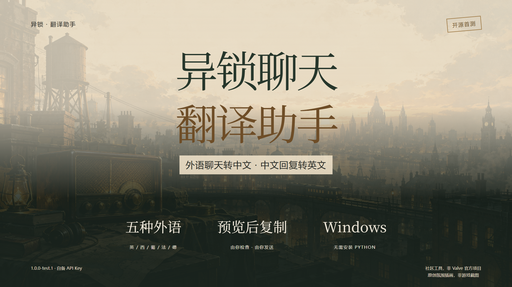
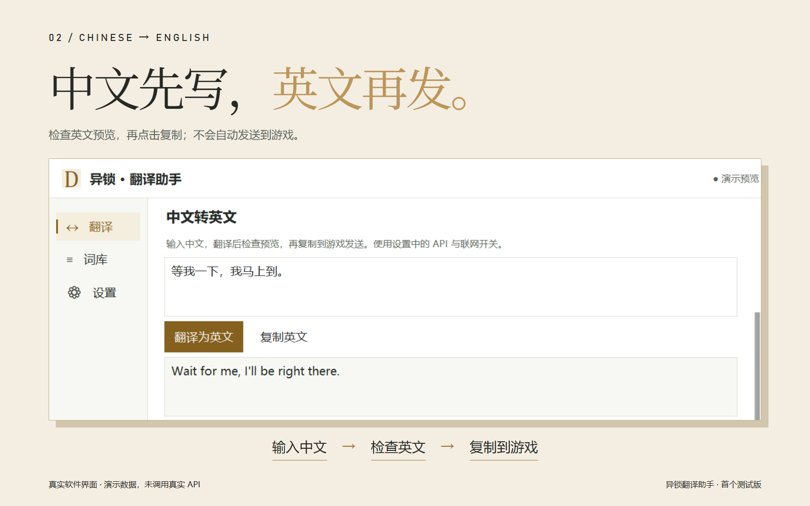

# 异锁聊天翻译助手 · Deadlock Translator

把外语聊天看懂，把中文回复说清。Windows 本地运行的《异锁》（Deadlock）聊天翻译工具，首个公开测试版。



**[下载 Windows 测试包](https://github.com/piaobo2233/deadlock-translato/releases/tag/v1.0.0-test.1)** · [直接下载完整 ZIP](https://github.com/piaobo2233/deadlock-translato/releases/download/v1.0.0-test.1/DeadlockTranslator-1.0.0-test.1-windows-x64.zip) · [提交问题](https://github.com/piaobo2233/deadlock-translato/issues)

## 能做什么

- 从屏幕识别聊天气泡，英 / 西 / 葡 / 法 / 德转简体中文；正文含汉字时整条跳过。
- 输入中文，检查英文预览，点击复制，再自行粘贴发送；不自动控制游戏发言。
- 保留三帧 OCR 确认与独立源图复核，常驻识别辅助进程可终止。
- 本地词库与有效结果优先复用；未知接口结果保留防重发记录。
- 默认待审核只列本局有绘制回执且质检通过的候选；下一局可手动切换。



## 普通玩家使用

1. 下载 Release 中的 `DeadlockTranslator-1.0.0-test.1-windows-x64.zip`，完整解压。
2. 首次安装包内 `首次安装OCR` 的官方安装器，已有 Tesseract 可跳过。保留默认位置和 English 组件，工具已附带六种模型。
3. 双击 `启动.vbs`。保留 `DeadlockTranslate.exe` 和 `_internal` 文件夹；无需安装 Python。
4. 在设置填写自己的 API Key、接口和模型，按需开启在线补充翻译。API 用量由服务商计费。
5. 打开游戏测试。默认只有游戏前台才识别；关闭主面板默认退出整个助手。

详细说明：[首版测试与分享](docs/guides/首版测试与分享.md)、[接收与中文转英文](docs/guides/接收与中文转英文.md)。

请分享初始完整 ZIP，**不要重新压缩运行后的文件夹**。程序旁的 `data/` 会保存你自己的配置、密钥、词库和请求记录。

## 测试版的边界

不同硬件、分辨率、缩放与网络仍需验证，可能漏译或误识别。整局“90% 在 2 秒内显示”的目标尚未完成真实验收。手动翻译目标为 5 秒内完成，接口等待 4.5 秒且不自动重试；这不是服务商成功响应的保证。

截图识别在本机完成；启用 API 后会把待翻译文字发送给你配置的服务商。工具源码开源不等于 API 免费。发布包未做代码签名，请核对下载来源与 SHA-256；不需要关闭系统防护。

本次 Windows 定向检查 24 项通过，并实际验证冻结程序启动、常驻 OCR 与主窗口退出。完整开发回归仍有 9 项失败、1 项错误及一项旧回归失败，均为已有基线问题，没有将其写成“全套通过”。部分识别回归依赖未公开的人工素材，公开仓库不包含私人对局帧或开发日志。

## 源码运行

Windows 64 位，Python 3.10 以上，并安装 Tesseract：

```powershell
pip install -r requirements.txt
python -m app
```

也可双击源码根目录 `启动.vbs`。入口为 `app/` 和 `gui/`；`scripts/run.py` 兼容打包启动。

不依赖私人截图的针对性检查示例：

```powershell
python -m unittest discover -s tests -p test_manual_waiting.py -v
python -m unittest discover -s tests -p test_portable_build.py -v
python -m unittest discover -s tests -p test_composer.py -v
```

生成测试包的工具为 `scripts/build_portable.py`，需要下载官方 OCR 安装器并核对工具内固定的摘要。工具只从允许的源码和资源构建，排除真实数据。源码 VERSION 为 1.0.0，测试包构建版本为 1.0.0-test.1。

## 反馈与宣传素材

反馈请附 Windows 版本、分辨率/缩放、显示模式、是否使用代理、复现步骤。截图遮住昵称，不上传 API Key 或整个 `data`。可从设置导出反馈 ZIP，检查后再自行提交。

[宣传素材与录屏页](docs/promo/README.md) 包含单文件 HTML、B 站封面/脚本与小黑盒图文稿。软件截图采用临时演示数据；氛围插画为原创生成素材，非游戏实录。

## 开源与归属

工具源码采用 [MIT](LICENSE)。第三方组件与模型许可见 [THIRD-PARTY-NOTICES](docs/THIRD-PARTY-NOTICES.md)。本项目与 Valve Corporation 无关联，不是官方产品，不包含游戏本体文件。
