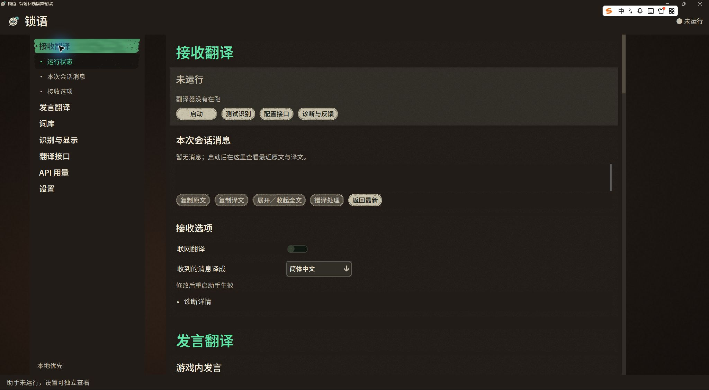

<h1 align="center">锁语 · LockLingo</h1>

《异锁》（Deadlock）的 Windows 聊天翻译助手

<strong>Windows 10/11 x64 · 内置 OCR</strong>

  <a href="https://github.com/piaobo2233/deadlock-translator/releases/latest"><strong>最新正式版 · 安装包、便携版与校验</strong></a> ·
  <a href="docs/guides/安装与首次使用.md">首次使用</a> ·
  <a href="docs/CHANGELOG.md">更新日志</a>

## 主要功能

- **接收翻译**。本机 OCR 读取英语、俄语、日语、韩语聊天，在气泡下显示简体中文。面板可查看并复制原文和译文。
- **发言翻译**。确认目标语言并主动开启后，在游戏中复制中文，助手把通过语言校验的译文写入剪贴板，由你粘贴并发送。
- **本地优先**。先查词库、记忆和缓存，未命中时可调用你配置的翻译服务。服务商可能计费。
- **个人词库**。新安装从 0 开始，接收 API 返回的合格中文译文自动收录；官方术语和常见缩写作为独立内置参考，不占个人词库计数。

## 安装、更新与卸载

- **首次安装**。下载 `LockLingo-<版本>-setup.exe`，安装到纯英文可写目录，例如 `D:\LockLingo`。在首次设置中框选游戏聊天区，也可先用参考范围。可跳过 API Key，先用本地词库、翻译记忆和缓存。需要翻译新句子时，配置接口并开启「联网翻译」。
- **更新**。安装版在「设置 → 软件更新」检查更新，也可将新安装包覆盖到原目录。个人资料随原目录保留。
- **卸载**。安装版在「设置 → 卸载 → 卸载锁语」打开卸载程序。保留资料可供原目录重装后继续使用。彻底卸载会永久删除安装目录内的个人资料和锁语创建的备份、识别留档。

详见[安装与首次使用](docs/guides/安装与首次使用.md)。

## 使用范围

主要面向主屏全屏或无边框模式。不同分辨率、缩放和对局场景下的识别效果会有差异。开启联网翻译后，待译文字随请求发给所选服务商，API Key 用于接口认证并以明文保存在本机程序目录的 `data/config.json`。自动检查、真实对局、显示环境和正式安装包的验收范围见下方测试状态。

[文档](docs/README.md) · [测试状态](docs/TESTING.md) · [反馈问题](https://github.com/piaobo2233/deadlock-translator/issues/new/choose) · [安全反馈](.github/SECURITY.md) · [第三方许可](docs/THIRD-PARTY-NOTICES.md)

自 1.2.1 起，新版本整体及新增原创修改采用 [GPL-3.0-only](LICENSE)，保留历史 MIT 授权；见[许可范围](docs/LICENSE-SCOPE.md)和[品牌规则](docs/BRAND.md)。锁语由社区独立维护，感谢开源项目和玩家的反馈。 [项目与素材说明](docs/PROJECT-NOTICE.md)
