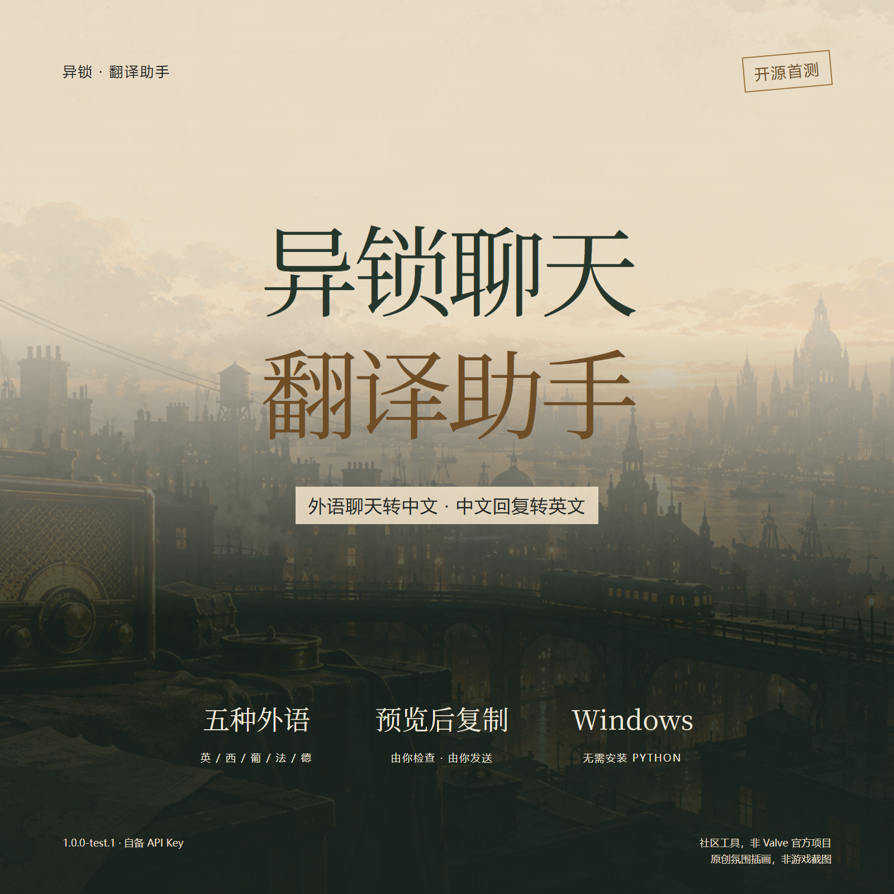
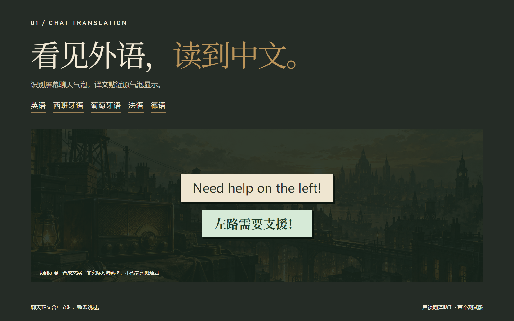
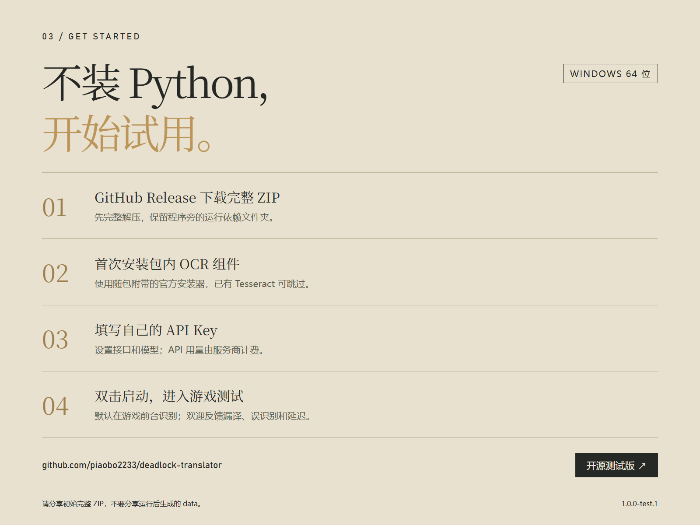

# 【开源首测】做了个《异锁》聊天翻译助手：外语转中文，也能中文回英文

我把这段时间做的《异锁》聊天翻译助手整理成了首个公开测试版，想找一些玩家一起试试，收集真实对局里的漏译、误识别和延迟问题。

它做的事情很直接：把屏幕里的外语聊天转成中文；想回复时，先写中文，检查英文预览，再复制到游戏里发送。

**现在可以测试这些功能：**

- 接收英语、西班牙语、葡萄牙语、法语和德语聊天，输出简体中文。
- 正文里出现中文时整条跳过，避免对已经看得懂的内容再翻一遍。
- 通过屏幕 OCR 识别聊天气泡，译文贴近原气泡显示。
- 本地词库和有效结果优先复用，需要时才使用你配置的在线 API。

**中文回复这部分，我保留了“预览 → 复制”的步骤。**

先看一眼英文是不是自己想表达的意思，再决定要不要发。输入改了，旧预览也会失效；工具不会替你自动向游戏发送消息。

**下载与使用**

Windows 10/11 64 位，无需安装 Python。完整解压后，首次按说明安装包内附带的官方 OCR 组件；已有 Tesseract 的朋友可以跳过。然后双击启动，在设置里填写自己的 API Key、接口和模型，按需开启在线补充翻译。

- 下载页：[GitHub Release · 1.0.0-test.1](https://github.com/piaobo2233/deadlock-translator/releases/tag/v1.0.0-test.1)
- 开源仓库：[piaobo2233/deadlock-translator](https://github.com/piaobo2233/deadlock-translator)

工具源码采用 MIT 许可证；API 用量由你选择的服务商计费，工具开源不等于 API 免费。截图识别在本机完成，开启 API 后会把待翻译文字发送给你配置的服务商。

**目前请按测试版来预期。** 不同分辨率、缩放、游戏显示模式与网络环境仍需要验证；可能漏译、误识别或遇到接口超时。我还没有完成整局“90% 在 2 秒内显示”的验收，也不会把成功样本当成整局表现。

如果愿意帮忙测试，反馈时请带上 Windows 版本、分辨率和缩放、游戏显示模式、是否使用代理，以及复现步骤。截图记得遮住昵称；不要发送 API Key 或整个 data 文件夹。

配图中的气泡为合成文案的功能示意，软件界面使用演示数据；氛围插画为原创生成素材，非实际游戏截图。本项目是玩家社区工具，与 Valve 无关联。

欢迎试用，也欢迎直接提 Issue。希望能让下一场队友交流少一点语言隔阂。

---

## 给发布者的上传顺序（正文发布时可删）

1. 标题使用第一行。
2. 配图按 `heybox-01-cover.png` → `heybox-02-receive.png` → `heybox-03-reply.png` → `heybox-04-install.png` 上传。
3. 图片与对应段落交替排版；平台不识别 Markdown 图片时，手动插入图片文件。
4. 发布前打开下载链接确认 Release 和 ZIP 已公开。不要上传个人运行后的 data、配置或聊天日志。
